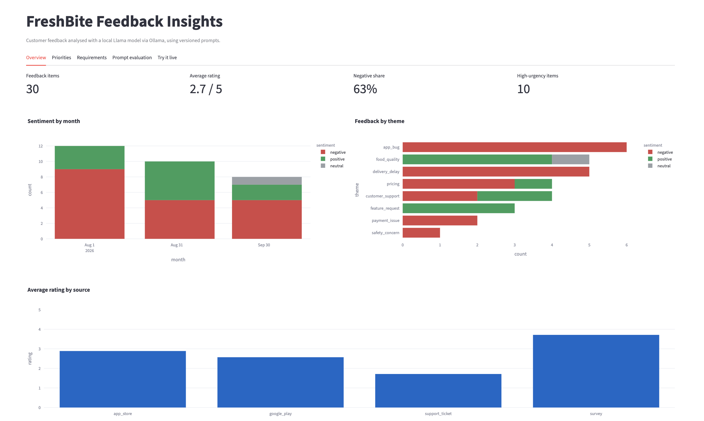
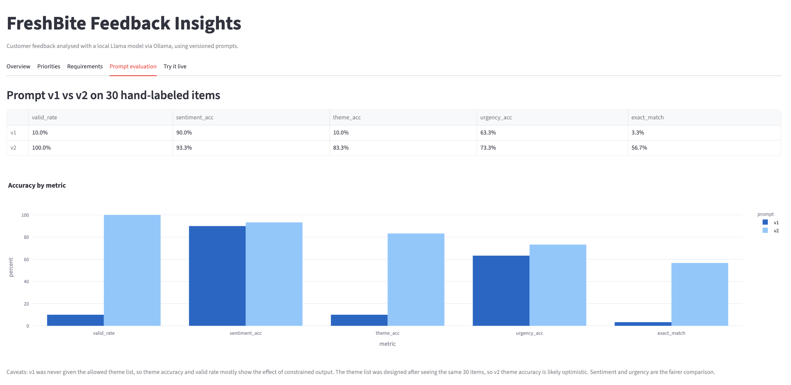
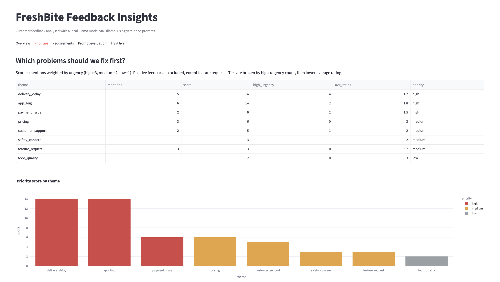
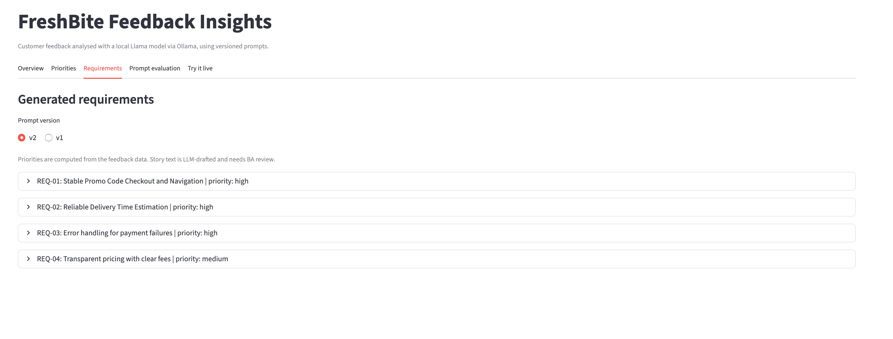
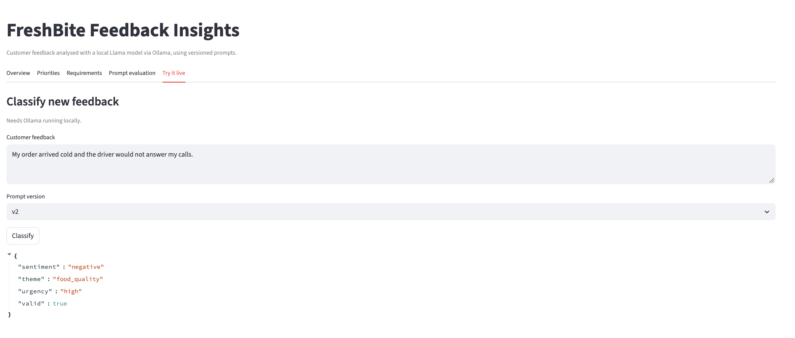

# FreshBite Feedback Insights & Requirements Generator

**Turns raw meal-delivery customer feedback into a ranked problem list and draft user stories, using a local Llama model and versioned, evaluated prompts.**

A business analysis + prompt engineering project. Everything runs locally (Ollama), so no customer data leaves the machine.



## At a glance

| | |
|---|---|
| **Business analysis** | Classifies feedback, ranks problems by a transparent urgency-weighted score, drafts traceable user stories with acceptance criteria, assumptions and open questions |
| **Prompt engineering** | Versioned prompts (v1 baseline, v2 constrained), output validation, hand-labeled eval set, per-metric comparison with mismatch reports |
| **Judgement** | Priority is computed from data, not decided by the LLM. Evaluation caveats are stated openly. Outputs are labelled as drafts for BA review |
| **Stack** | Python, Ollama (`llama3.2:3b`), pandas, Streamlit, Plotly |

## Results

### Prompt v1 vs v2 (30 hand-labeled items)

| Metric | v1 | v2 |
|---|---|---|
| Valid output rate | 10.0% | **100.0%** |
| Sentiment accuracy | 90.0% | 93.3% |
| Theme accuracy | 10.0% | 83.3% |
| Urgency accuracy | 63.3% | 73.3% |
| Exact match (all 3 labels) | 3.3% | **56.7%** |

**What changed in v2:** an explicit allowed-label list, strict JSON output rules and clearer urgency definitions.

**Caveats:** v1 was never shown the theme list, so valid rate and theme accuracy mostly measure format compliance. The theme taxonomy was designed on the same 30 items, so v2 theme accuracy is likely optimistic. Sentiment (+3.3 pts) and urgency (+10 pts) are the fairer comparison. A fresh held-out set is the next step.



### Which problems to fix first

Score = mentions weighted by urgency (high=3, medium=2, low=1). Positive feedback is excluded except feature requests. Ties are broken by high-urgency count, then lower average rating.

| Rank | Theme | Mentions | Score | High urgency | Avg rating |
|---|---|---|---|---|---|
| 1 | delivery_delay | 5 | 14 | 4 | 1.2 |
| 2 | app_bug | 6 | 14 | 2 | 1.8 |
| 3 | payment_issue | 2 | 6 | 2 | 1.5 |
| 4 | pricing | 3 | 6 | 0 | 3.0 |

Delivery delay and app bugs tie on score, but delivery delay wins the tiebreak: more high-urgency items and a lower average rating.



### Generated requirements

Drafted for the top-ranked themes, each with source feedback IDs for traceability:

- REQ-01: Stable promo code checkout and navigation (high)
- REQ-02: Reliable delivery time estimation (high)
- REQ-03: Error handling for payment failures (high)
- REQ-04: Transparent pricing with clear fees (medium)



See a full example in [`docs/sample_brd.md`](docs/sample_brd.md) and generated output in `docs/requirements_v2.md`.

### Try it live

Paste new feedback, choose a prompt version and classify it with the local model.



## How it works

```
data/feedback.csv
  -> classify (sentiment, theme, urgency) + validate   src/classify.py
  -> evaluate prompts vs hand labels                    src/evaluate.py
  -> rank themes (rule-based score)                     src/requirements_gen.py
  -> draft user stories with the LLM                    src/requirements_gen.py
  -> Streamlit dashboard                                app.py
```

- **Taxonomy:** sentiment (positive / neutral / negative), urgency (low / medium / high), and nine themes: `delivery_delay`, `app_bug`, `pricing`, `payment_issue`, `customer_support`, `food_quality`, `feature_request`, `safety_concern`, `other`.
- **Validation:** every response is checked for valid JSON and allowed labels. Invalid rows are marked `valid=False` and excluded from ranking.
- **Traceability:** every requirement lists the feedback IDs it came from.

## Quick start

Requires Python 3.9+ and [Ollama](https://ollama.com/).

```bash
python3 -m venv venv
source venv/bin/activate
pip install -r requirements.txt

ollama pull llama3.2:3b
ollama serve            # skip if Ollama is already running

python -m src.classify v2          # classify feedback
python -m src.evaluate v1 v2       # compare prompts
python -m src.requirements_gen v2 v2   # rank themes + draft requirements
streamlit run app.py               # open the dashboard
```

No Ollama? Run `export LLM_MODE=mock` first for a keyword-based demo of the workflow. Mock output is not an LLM quality benchmark. `LLM_MODE` and `LLM_MODEL` are read at import time, so set them before starting Python or Streamlit.

<details>
<summary><b>Project structure</b></summary>

```text
.
├── app.py                  # Streamlit dashboard (5 tabs)
├── src/
│   ├── llm.py              # Ollama/mock adapter, JSON parsing
│   ├── classify.py         # Classification, validation, CSV workflow
│   ├── requirements_gen.py # Theme ranking and requirement generation
│   └── evaluate.py         # Prompt comparison, mismatch reports
├── prompts/
│   ├── v1/                 # Baseline prompts
│   └── v2/                 # Constrained prompts with detailed rules
├── data/                   # Feedback, classified results, requirement JSON
├── eval/                   # Hand labels, metrics, mismatch CSVs
├── docs/                   # Screenshots, generated requirements, sample BRD
└── requirements.txt
```
</details>

<details>
<summary><b>Dashboard tabs</b></summary>

1. **Overview:** counts, average rating, negative share, urgent items, sentiment by month, themes, rating by source
2. **Priorities:** urgency-weighted theme ranking
3. **Requirements:** stories, acceptance criteria, assumptions, open questions, source IDs (switch prompt version)
4. **Prompt evaluation:** v1 vs v2 metrics and caveats
5. **Try it live:** classify a single new comment
</details>

<details>
<summary><b>Troubleshooting</b></summary>

- **`command not found: python`:** use `python3` to create the venv, then `python` after activating it.
- **Ollama connection or model error:** check `ollama list`, run `ollama pull llama3.2:3b`, or use `LLM_MODE=mock`.
- **Dashboard says data is missing:** run `python -m src.classify v2` from the project root.
- **A tab is empty:** run the matching evaluate or requirements command, then refresh.
</details>

## Limitations and responsible use

- Small dataset (30 items), so metrics demonstrate prompt iteration, not production performance.
- Outputs are drafts for a business analyst. Check source comments before prioritising work.
- Urgency is a triage signal, not an SLA. The project does not estimate effort or feasibility.
- Don't put sensitive customer data into prompts unless your data policy allows it.